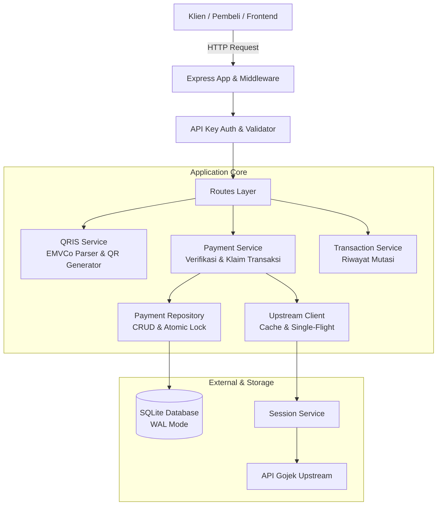
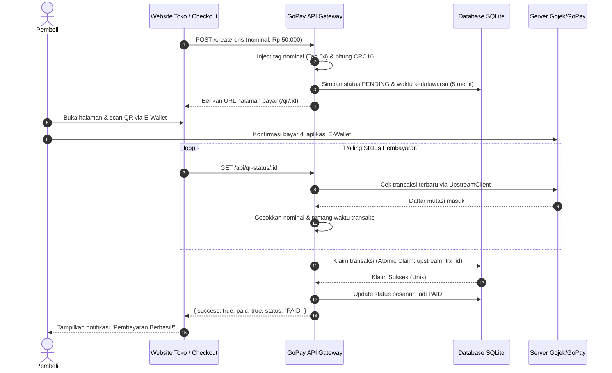

# GoPay Merchant Gateway & QRIS Verification API

Gateway pembayaran mandiri berbasis **Bun** dan **SQLite** yang mengubah QRIS statis merchant GoPay menjadi **QRIS Dinamis** dengan verifikasi pembayaran otomatis langsung ke server Gojek/GoPay tanpa pihak ketiga (payment gateway berbayar).

---

## 💡 Tentang Aplikasi Ini

Jika kamu memiliki toko atau aplikasi online dan ingin menerima pembayaran via QRIS GoPay, biasanya kamu harus mendaftar ke Payment Gateway pihak ketiga yang memotong biaya admin (fee per transaksi).

Aplikasi ini adalah **solusi mandiri**:
1. Mengubah kode QRIS Statis toko fisik kamu menjadi QRIS Dinamis (nominal pembayaran terkunci otomatis di aplikasi pembeli).
2. Mengecek mutasi uang masuk secara otomatis ke akun GoPay Merchant kamu.
3. Mengonfirmasi pembayaran lunas secara instan dan aman (anti dobel klaim).

Didesain ringan, cepat, dan mudah dipahami bahkan oleh junior developer.

---

## 🛠️ Tech Stack

- **Runtime**: [Bun](https://bun.sh/) (eksekusi JavaScript super cepat)
- **Web Framework**: [Express.js](https://expressjs.com/) (routing HTTP & middleware)
- **Database**: [SQLite](https://bun.sh/docs/api/sqlite) via `bun:sqlite` (penyimpanan persisten berbasis file dengan mode WAL yang cepat & aman dari race-condition)
- **QR Generator**: `qrcode` (membuat QR code langsung di lokal server tanpa API eksternal)
- **HTTP Client**: `axios` (komunikasi ke upstream API Gojek)
- **Linter & Formatter**: [Biome](https://biomejs.dev/)

---

## ✨ Fitur Utama

- **Dynamic QRIS Generator**: Mengubah string QRIS statis standar EMVCo menjadi dinamis dengan nominal yang ditentukan, lengkap dengan kalkulasi ulang checksum CRC16.
- **Halaman Checkout Interaktif**: Web checkout bawaan berdesain modern (Dark Mode), responsif, dilengkapi countdown timer dan auto-polling status pembayaran.
- **Local QR Engine**: Gambar QR dibuat langsung di server (PNG Buffer / Base64 Data URL) tanpa bergantung pada layanan pihak ketiga.
- **Verifikasi Pembayaran Otomatis**: Mendeteksi dana masuk secara real-time berdasarkan nominal, rentang waktu transaksi, dan status transaksi.
- **Anti Double-Claim**: Menggunakan SQLite atomic transaction; satu transaksi upstream Gojek tidak dapat diklaim lebih dari satu kali.
- **Single-Flight & Smart Caching**: Mencegah request berlebihan ke upstream Gojek jika ada banyak request polling di waktu yang bersamaan.
- **Auto-Refresh Sesi**: Memperbarui token GoPay secara berkala di latar belakang agar layanan tetap aktif tanpa login ulang manual terus-menerus.
- **Keamanan**: Dilindungi autentikasi `x-api-key`, validasi input nominal, proteksi XSS pada tampilan, dan pembatasan ukuran payload HTTP.

---

## 📐 Arsitektur Sistem

Aplikasi menggunakan arsitektur berlapis (_layered architecture_) yang memisahkan tanggung jawab kode:



---

## 👥 User Story

### 1. Pembeli (Customer)

> _"Sebagai pembeli, saya ingin memilih produk, melihat kode QRIS dengan nominal yang sudah pas, membayarnya dengan GoPay/BCA/Dana/e-wallet apa saja, dan melihat status di layar otomatis berubah menjadi 'Lunas' tanpa perlu upload bukti transfer."_

### 2. Pemilik Toko / Merchant

> _"Sebagai merchant, saya ingin menerima pembayaran QRIS langsung ke akun GoPay toko saya tanpa potongan MDR perantara tambahan, dan sistem toko saya langsung tahu saat dana masuk."_

### 3. Developer / Sistem Backend

> _"Sebagai developer, saya ingin memanggil satu endpoint `/create-qris` untuk mendapatkan link bayar, lalu memverifikasi status pembayaran baik lewat webhook/polling `/check-payment` secara aman dan andal."_

---

## 🔄 Cara Kerja Aplikasi

Berikut alur lengkap dari saat pesanan dibuat hingga pembayaran terverifikasi:



---

## 📡 Daftar Endpoint Utama

| Method     | Endpoint             | Auth    | Deskripsi                                                |
| ---------- | -------------------- | ------- | -------------------------------------------------------- |
| `GET`      | `/health`            | Publik  | Cek kesehatan server                                     |
| `GET`      | `/token-status`      | API Key | Cek apakah sesi login GoPay masih aktif                  |
| `POST/GET` | `/create-qris`       | API Key | Membuat QRIS Dinamis baru                                |
| `GET`      | `/qr/:id`            | Publik  | Halaman interaktif checkout pembayaran QRIS              |
| `GET`      | `/qr/:id?format=raw` | Publik  | Stream gambar mentah QR dalam format PNG                 |
| `GET`      | `/api/qr-status/:id` | Publik  | Cek status pembayaran satu QRIS (untuk polling frontend) |
| `POST/GET` | `/check-payment`     | API Key | Verifikasi manual pembayaran (Server-to-Server)          |
| `GET`      | `/transactions`      | API Key | Mengambil daftar riwayat transaksi mutasi GoPay          |
| `GET`      | `/api/logs`          | API Key | Melihat riwayat log aktivitas gateway                    |

> 💡 **Postman Collection**: File Postman Collection siap pakai tersedia di [`docs/gopay-api.postman_collection.json`](docs/gopay-api.postman_collection.json).

---

## 🚀 Panduan Memulai (Quick Start)

### 1. Prasyarat

- Pasang [Bun](https://bun.sh/) (versi 1.1 ke atas).

### 2. Konfigurasi Lingkungan

Duplikasi file `.env.example` menjadi `.env` dan lengkapi datanya:
```env
PORT=3000
API_KEY=rahasia_api_key_kamu
QRIS_STATIC=00020101021126... (kode QRIS statis dari aplikasi GoBiz/GoPay Merchant)
GOPAY_MERCHANT_ID=merch_xxxx
PUBLIC_BASE_URL=http://localhost:3000
```

### 3. Login Akun GoPay

Jalankan skrip autentikasi untuk menyimpan sesi token:
```bash
bun run login
```
_Ikuti instruksi input nomor HP GoPay dan kode OTP di terminal._

### 4. Jalankan Aplikasi

```bash
# Mode pengembangan (auto-reload saat file berubah)
bun run dev

# Mode produksi
bun run start
```

### 5. Menjalankan Pengujian (Testing)

Semua unit dan integration test dapat dijalankan dengan:
```bash
bun test
```
